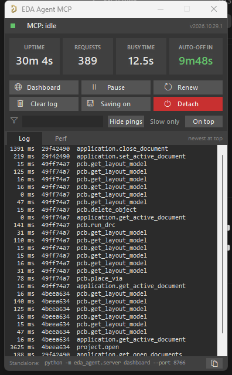
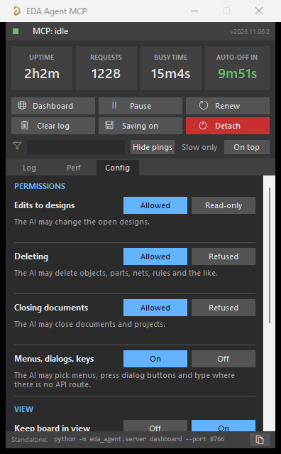
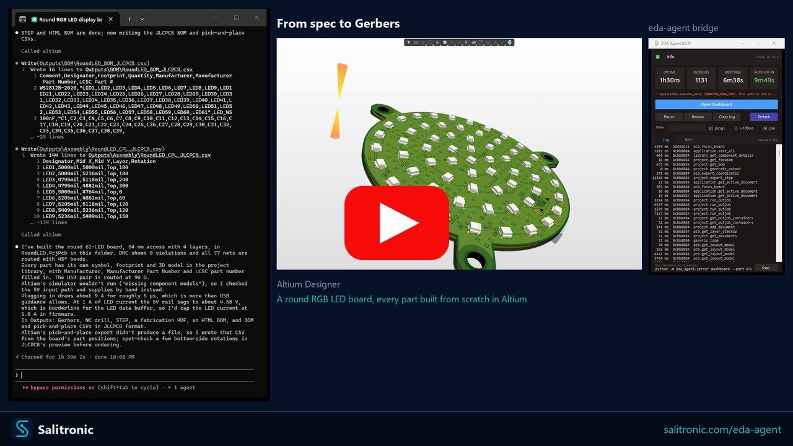
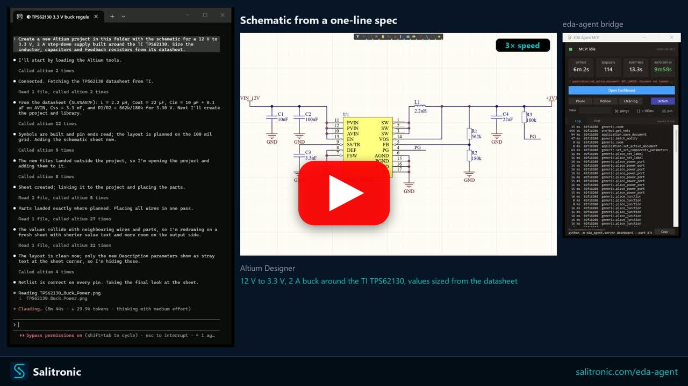

# Features

What eda-agent does, how it connects to Altium, and what a session with it looks like.

## How it works

- Altium Designer stays open and in full control of your design
- A DelphiScript polling loop runs inside Altium's scripting engine
- `eda-agent` (Python, launched by your MCP client) sends commands via file-based IPC
- Altium executes, writes a response, and returns to polling
- You see the changes happen live in Altium

This is **not** a batch tool that opens a project, runs a script, and exits. It's a live connection for as long as you want it (conversational design review, guided refactoring, ad-hoc BOM queries, "what nets does this resistor connect to?"), all on the project you currently have open.

## Dashboard

 

Two dashboards ship with eda-agent:

- **In-Altium status window** - a floating Altium-side window showing live status, request count, cumulative Altium-side time, auto-shutdown countdown, and a per-command log with durations. `Hide pings` filters the 30 s keep-alive traffic; `Slow only` isolates slow calls. The **Config** tab (right) sets what the AI may do: edit designs, delete, close documents, and drive menus and dialogs, plus view options. Changes apply live. The **Detach** button exits the polling loop cleanly; it saves nothing, so unsaved edits stay in the editor.
- **Web dashboard** - a local browser dashboard at `http://127.0.0.1:8766`, focused on design review. A **Review** tab surfaces datasheet / MPN / manufacturer / footprint coverage gauges and an actionable issue queue (missing datasheet, missing MPN, orphan nets, ...); **Project**, **Components**, **Nets**, **Libraries** and **Plan** tabs give live structured views. Click any component or net to drill into a detail drawer; one click cross-probes it into Altium. Light / dark theme, server-sent-events live feed. It is auto-started by the MCP server - the **Open Dashboard** button on the in-Altium status window launches the browser.

## Demo

Claude Code with eda-agent designs a round 54 mm, 4-layer RGB LED display board in Altium Designer from a written spec to manufacturing files. It builds a project library from scratch, with a symbol, footprint, 3D model and part numbers for every part. It then draws the schematic, places 61 LEDs in rings, routes the USB pair at 90 ohms, pours stitched ground, gets DRC clean and writes the Gerbers, drill, BOM, pick-and-place and STEP files. A correction round follows: a review prompt lists issues from the first pass, and Claude reroutes the whole USB pair as a coupled differential pair, gives every part a realistic 3D model from its datasheet drawing and finishes the schematics with title blocks. The result would still get a manual tweaking pass before prototyping, but it is already at a very good stage.

Claude Code with eda-agent draws a 12 V to 3.3 V, 2 A step-down supply around the TI TPS62130 in Altium Designer from one sentence. It fetches the datasheet, sizes the inductor, capacitors and feedback divider from it, builds the symbols, draws the schematic and verifies the netlist.

## Everything it does

- **~687 tools on the default Altium backend** (773+ with both registered) across application, project, library, schematic/general, PCB, and design-agent categories. Three more, the [NPI phase gates](USING_THE_TOOLS.md#npi-phase-gates), are off until you ask for them
- **Generic primitives** (`obj_query`, `obj_modify`, `obj_create`, `obj_delete`, `obj_run_process`) that work on almost any schematic or PCB object type via late-binding, avoiding per-type handler proliferation. They reach **1626 of the 2207 properties Altium's own SDK declares (73.7%)** across 46 object types, measured against `Altium.SDK.Interfaces.dll` rather than estimated: `eda-agent sdk-coverage` prints the figure and names every property still out of reach. See [SDK coverage](SDK_COVERAGE.md)
- **Every tool takes a list**: give nearly any tool `items`, a list of its own arguments, and the whole list is one call, one request to Altium and one undo step (`pcb_place_arc(items=[...])` places twenty arcs that one Undo takes back). The reply gives each item's result in order. Some tools take their list directly: `pcb_place_tracks`, `pcb_place_vias`, `pcb_move_components`, `sch_place_wires`, `sch_place_components`, `sch_set_components_parameters`, `lib_add_pins`, `proj_get_connectivity_many`, `sim_attach_primitives`. Typical wall-time savings: 10 to 100x on multi-item edits
- **Design review snapshot**: `design_review_snapshot` bundles 8 to 12 review reads (project info, components, nets, rules, diff, messages, stats, unrouted, BOM) into a single call. One LLM turn instead of a dozen
- **Design-lint sweep**: `design_lint_report` runs 31 audit checks in one IPC pass and returns a structured violation list - schematic-side (component-parameter visibility per class, power-port orientation, floating ports, multi-output / no-driver nets, duplicate designators, off-grid components) and PCB-side (DNP variant components, tented-via ratio, near-miss track endpoints, signal vias without nearby return via, via antennas, removed pad shapes, components outside outline, pads too close to board edge, invalid polygon regions, optional DRC). Each check is also exposed as a standalone `audit_*` MCP tool; the dashboard's Status → Health subtab has a one-click Lint panel that calls `/api/lint` and groups results by Schematic / PCB
- **Canonical circuit blocks**: `design_add_circuit_block` folds a whole block into a `DesignPlan` in one call, allocating refdes, wiring every pin to the right net and tagging power / ground and roles. Twelve of them: `decoupling`, `pullup`, `pulldown`, `series_resistor`, `voltage_divider`, `rc_lowpass`, `rc_highpass`, `led_indicator`, `crystal`, `pi_filter`, `mosfet_low_side`, `mosfet_high_side`. Naming-agnostic: you supply the part identities, it owns only the wiring pattern. `design_list_circuit_blocks` returns each one's parameter contract, so the planner never guesses a parameter name
- **Datasheet-first discipline**: every component-surfacing response (`pcb_get_components`, `proj_get_bom`, `proj_get_component_info_many`, `proj_find_component`, `lib_search`, `design_review_snapshot`, `sim_get_readiness`) carries a `_datasheet_guidance` block with per-part vendor search queries. `app_attach` / `app_ping` carry a `_system_reminder` on their first call and every 10th after it (`EDA_AGENT_REMINDER_EVERY` sets the interval), so every MCP client that connects sees the rule at session start and again later. LLM-fabricated datasheet values are forbidden; WebFetch/WebSearch are called out by name
- **Sch <-> PCB netlist crossref**: `obj_crossref_net(net_name)` compares the schematic pin list against the PCB pad list for the same net. Catches ECO drift, stale post-fabrication routing, phantom nets from port/sheet-entry rename conflicts. `in_sync` flag + `sch_only` / `pcb_only` diff
- **SPICE simulation workflow**: `sim_get_readiness` audits every component and partitions into ready / needs-primitive / needs-file. `sim_attach_primitives` sets SpicePrefix + Value on passives. `sim_attach_model` links a vendor `.mdl` / `.ckt`. `sim_run` dispatches the simulator. Built-in guardrail: never fabricate a SPICE model file, fetch the vendor one
- **SPICE model library and LTspice round trip**: `sim_scan_models` indexes vendor model files and LTspice symbols, `sim_find_models` finds them by MPN, `sim_get_pin_map` matches symbol pins to model nodes by name, and `eng_ltspice_export` and `eng_ltspice_compare_schematic` carry a deck to the LTspice GUI and check an LTspice schematic against the Altium one. See [SPICE models and LTspice](SPICE_MODELS.md)
- **EMI/EMC pre-scan and openEMS**: `sim_emc_prescan` finds fast tracks crossing a plane split, near the board edge or changing layer with no return via, and estimates radiated emission against CISPR 32 or FCC Part 15 lines with no external program. `sim_em_build_model` and `sim_em_run` solve a few nets in openEMS for S-parameters and antenna patterns. See [EMI/EMC and RF](EMC_RF.md)
- **Thermal analysis**: `sim_thermal_analysis` solves the board's steady temperature field in 3D from the power each part dissipates: the real copper of every layer, plated holes, anisotropic laminate, natural or forced convection and radiation. It reports the peak, hotspots, each part's pad, junction and case temperature against its limit, the hottest unpowered parts, a heat balance and a grid-convergence error estimate, and writes a heat map per layer. Checked against exact solutions. See [Thermal analysis](THERMAL.md)
- **Symbol and footprint preview**: `lib_preview_part` draws a library part's symbol and footprint as SVG before it is placed, without opening or changing anything in Altium; the dashboard's Library pane has the same lookup over the scanned Altium 365 library
- **Fab and IPC rule floors, on demand**: `pcb_rules_fab_floors` holds the board's rules against one fab build's published minimums and the profile's IPC class floors, rule by rule with the quote behind each floor, and with `apply=True` raises only board-wide rules that sit below. See [IPC standards](IPC_STANDARDS.md)
- **Focus-independent PCB access**: every PCB handler falls back to `GetPCBBoardByPath` when `GetCurrentPCBBoard` returns nil (user has a sch tab focused). No more misleading "No PCB document is active" when the PCB is right there
- **Fast and compile-cached**: the polling loop runs at a 10 ms interval in active mode, which bounds the bridge's own latency rather than describing what a call costs - measure yours with `eda-agent perf`, which joins the two timing logs and separates time spent inside Altium from time spent getting there. `SmartCompile` caches `DM_Compile` with a 2 s TTL so a multi-read review pays for one compile instead of a dozen. Explicit `proj_force_recompile` + `proj_get_compile_freshness` probes for cases that need a guaranteed-fresh netlist (e.g. after user edits)
- **Persistent polling loop**: one script start, then a 10 ms poll interval in active mode (30 ms idle), so the loop is not what a call waits on
- **Editor and project settings, read back**: board grids and the sheet's electrical grid, board and schematic editor preferences, auto-save, and project options (net identifier scope, output path, pin swapping). Every value written is read back, and one that did not take is reported in `not_applied`
- **Rigid-flex and route clean-up**: split a board into layer stack regions, give each region its own stack (a flex stack with fewer copper layers), add and edit bend lines with radius, angle and fold order, and run Altium's Gloss or Retrace on chosen nets with the track count and length reported before and after
- **Layer stack manager**: the whole physical stack with Z heights and finished thickness, dielectric and solder mask settings (Dk, Df, thickness, stiffener), layers inserted above or below a chosen layer, impedance profiles created and set per layer, and each via's protection structure and back drilling
- **Board output and editor settings**: the Gerber and print setup saved in a board, Testpoint Style rules, the coarse visible grid factor and each grid's unit, what pasting keeps and the paste array, confirmations, auto-pan and netlist-load behaviour, display fonts and colours, more schematic preferences, a pad's drill type, and sheet reference zones for every part, label and port
- **Net colour highlighting**: give board nets a colour and draw them in it, or copy each net's project (schematic) colour onto the board so both highlight alike
- **Annotation runs silently**: `proj_annotate` designates components without popping the annotate dialog
- **Drives the GUI where there is no API**: a great deal of Altium exists only as menus and dialogs. `app_menu` clicks through the real menu bar by name (and lists what a menu holds, so paths are discovered rather than guessed); `app_list_open_dialogs` reports what is on screen, what it says and whether Altium is stuck; `app_ui` sets checkboxes, fields, dropdowns and grid rows; `app_press_dialog_button` presses one button; `app_drive_dialogs` answers a whole sequence reactively. **None of it uses the bridge**, only Win32 and the accessible layer, so it keeps working while a modal has the scripting engine blocked, which is exactly when you need it. `app_menu` with `how="drive"` fires a menu command and answers its dialogs in the same call, because a command that opens a modal blocks the bridge and a second call would never arrive. The driver decides from what is on screen rather than from a script, stops on any dialog it cannot classify, and gates the press that changes the design behind `allow_commit`. Dialog text that Altium paints into handle-less controls is recovered by OCR and labelled as read from pixels, not text
- **Deferred save for speed**: mutations mark documents as modified in memory; disk writes happen on explicit `app_save_all`, and `app_detach` saves the documents that were edited. A clean document is never rewritten, and edits are not slowed by a save each
- **Two dashboards**: an in-Altium floating status window (status, request count, per-command performance, command log, Detach button) and a browser-based **web dashboard** (`127.0.0.1:8766`) for design review - datasheet / MPN / footprint coverage gauges, an actionable issue queue, component / net drill-in, one-click cross-probe into Altium, light / dark theme. The whole project view loads in one bundled IPC round-trip (`project.dashboard_snapshot`); the web dashboard auto-starts with the MCP server
- **DelphiScript trap linter**: `scripts/altium/lint.py` (wired into `build.py`) scans the Pascal sources for known parser hazards - `Cardinal()` casts, malformed hex literals, empty `.Add('')` arguments, braces inside comments, fixed-size arrays as function locals, reserved-word identifiers - and fails the build before a bad deploy
- **Activity logs**: every command is appended to `workspace/activity.log` (one CSV line per command: timestamp, duration, command name, status, response size and the full response). The bridge also writes `bridge_trace.log` for IPC-level diagnostics. On the Python side, a rotating, size-capped, secret-redacting JSON-lines log (`%USERPROFILE%\EDA Agent\logs\eda_agent.log` by default) runs alongside the server's existing stderr logging - see [Configuration](CONFIGURATION.md#configuration)
- **Engineering tools**: IPC-7351B footprint calculation and library validation (offline and against a live SchLib/PcbLib pair), owner naming/rules policies, design-intent validation, LTspice batch runs, pre-ECO schematic/PCB diff, and read/write access to an Altium 365 workspace by **either route**: through Nexar, or straight to the workspace's own GraphQL API. The direct route reaches what Nexar does not proxy (comments, threads, tasks, workflows, script executions), and `altium365_describe_type` introspects the live schema so a field is discovered rather than guessed. Full detail, including which parts are offline-tested versus unverified against live Altium/Nexar, is in [Engineering tools](ENGINEERING_TOOLS.md)
- **Fab output verification**: `pcb_check_fab_output` reads an exported Gerber/Excellon package back and compares it against the live board - copper layer count vs the stackup, outline size, drill hits vs pads and vias, and minimum drill/feature against your fab's limits. Closes a loop that was open: eda-agent could write a fab package but never read one. See [Checking the fab package](FAB_AND_CALCULATORS.md#checking-the-fab-package)
- **Logo / artwork on the board**: `pcb_place_image` turns a PNG or BMP into PCB region primitives (silkscreen logo, QR code, artwork). The image is decomposed into non-overlapping rectangles rather than traced outlines, so nothing is approximated away from the source art and holes need no special handling. Plans by default (`dry_run=True`) and reports the primitive count first, because anti-aliased artwork can decompose into thousands of pieces, with a `max_regions` cap that a photograph will hit immediately. Verified on a live board: an asymmetric test glyph was placed and read back to confirm scale, origin corner and layer, and that the art is neither mirrored nor flipped
- **Headless library reads**: `lib_read_pcblib_headers` parses a `.PcbLib`'s footprint names, pad counts, heights and descriptions straight out of the OLE container with Altium closed (the `.SchLib` side already backs the `altium_local` provider and the offline review). Pad geometry stays a live read: it lives in Altium's binary primitive region, which this project does not reverse-engineer without ground truth
- **Owner profiles**: per-workspace house style (footprint-authoring defaults like pad corner rounding, design rules, fab/stackup profiles, naming conventions, schematic units/grid, project templates), auto-discovered from a project-local `.eda-agent/profile/` or a centrally-switched `eda-agent profile-use <name>`. See [Profiles](PROFILES.md)
- **Optional Rust compute**: `eda-agent --compute rust` (or `EDA_AGENT_COMPUTE=rust`) runs the routing planner's grid search in a compiled wheel built from `rust/eda_agent_compute`, which is about 16x faster on a 1090-pad board at a 10 mil grid, with byte-identical results. Python stays the default and the wheel is optional. See [Rust compute](RUST_COMPUTE.md)
- **Bulk-tool nudge**: when a singular tool is hit 2 to 3 times in 10 s, the response carries a `_hint_bulk` field pointing at the batch variant. Clients that missed the bulk tool in the docstring learn about it at runtime
- **Design agent surface**: MCP tools (`design_get_discipline`, `design_snapshot_inventory`, `design_validate_plan`, `design_audit_schematic`, `design_validate`) that let an MCP-client LLM produce a structured `DesignPlan` JSON, audit the drawn sheet for layout problems, and validate ERC + connectivity. Datasheet-first, NDA-isolated by construction
- **Schematics drawn from a hand template**: the LLM plans the sheet the way an engineer draws it, every coordinate on the grid (rails as straight wires, capacitors hanging to ground, a divider whose midpoint runs straight to its pin), writing wires through pin anchors such as `U1.EN`. `sch_preview_template` checks the template and draws it to a PNG without touching the sheet; `sch_draw_template` places the parts, reads their pins back, checks the wiring against those pins and the plan's nets, refuses a short or a misplaced part before the first wire, then draws the wires, power ports and labels and stamps the part data. On EasyEDA, `easyeda_emit_template` and `easyeda_emit_template_connections` do the same in two passes
- **Atomic-parts contract**: every existing-status Part must carry `mpn`, `footprint`, `datasheet_url`; the inventory snapshot exposes those fields per component; `design_validate` emits `atomic_parts` warnings when the contract is missed. Aligns with the KiCad Atomic / Digi-Key Library / atopile / JITX convention
- **Schematic audit**: `design_audit_schematic` returns structured `{overlaps, wire_crossings, stacked_ports}` for the active schematic - pairs of components whose bboxes intersect, wire segments crossing a non-endpoint component body (real Pascal-side `Vertex.*` + `BoundingRectangle.*` accessors), and clusters of 3+ rail glyphs of the same net. Each violation carries enough geometry for the planner to compute a corrective move. Programmatic feedback loop without needing a visual snapshot
- **Health and doctor preflight**: `eda-agent health` (offline checks: workspace dir, pointer file, bundled scripts) and `eda-agent doctor` (full preflight talking to Altium: process running, script polling responsive, version match, a read-only command canary, optional `--library` lib-path checks). `--json` for machine-readable output
- **3D bodies and STEP models in footprints**: `lib_set_3d_body` edits a body already in a footprint, `lib_create_3d_model` builds one from a package drawing (extruded when neither CadQuery nor FreeCAD is installed, and it says so), `lib_export_3d_model` writes it out, and `lib_extract_embedded_models` gets the ORIGINAL STEP files back out of a `.PcbLib` with Altium closed
- **Impedance from Altium's own solver**: `pcb_get_impedance_profiles` reads the profiles in the board's Layer Stack Manager rather than recomputing them, so the number quoted is the one Altium will fabricate to
- **pip-installable**: no admin, no installer, no touching Altium's config

## Example use cases

### Full-project design review

> *"Do a design review of the PoE front-end. Pull the snapshot, fetch the TPS2372 and TL072 datasheets, and flag anything that doesn't match."*

One `design_review_snapshot` call gives the AI project info, design stats, components, nets, rules, diff, messages, board stats, and BOM, plus a datasheet-fetch checklist. The AI then grounds every recommendation in the vendor datasheets it actually pulled. 8 to 12 separate queries collapse into one tool call.

### Schematic review

The AI reads your schematic live. Ask it anything a reviewer would:

> *"List every component connected to the 3V3 rail and flag anything whose datasheet limit is below that."*
>
> *"Find all net labels that appear only once across the whole project. Those are probably typos."*
>
> *"What's driving the /RESET net? Walk the connectivity and tell me where it resets and how."*
>
> *"Do any two components share a designator prefix with gaps in numbering (e.g. R1, R2, R4)? Re-annotate or tell me what's missing."*
>
> *"Compare the focused schematic to the version from 3 weeks ago. What parameter values changed?"*

Behind that, the AI calls tools like `obj_query(object_type="eSchComponent", scope="project")`, `proj_get_connectivity_many(designators=[...])`, `proj_get_nets(...)`, `obj_modify(...)`, and so on. You watch Altium repaint as it works.

### Sch ↔ PCB drift detection

> *"Run `obj_crossref_net` on POE_PG. The PCB seems to have R7 on this net but I'm not sure the schematic still does."*

The response shows sch pins, PCB pads, matched count, and the diff in each direction. A non-empty `pcb_only` list means the board was fabricated from an earlier schematic revision and a later edit broke the post-ECO merge; catch this before the next ECO push rips routed connections. `in_sync: false` plus the exact diff tells you which port or sheet-entry rename to undo.

### SPICE simulation setup

> *"Set this schematic up for an AC sweep. Attach SPICE primitives to every passive, fetch vendor SPICE models for the op-amps, and tell me if any part can't be simulated."*

`sim_get_readiness` partitions the design into `ready` / `needs_primitive` / `needs_file`. The AI batches primitives onto every passive in one `sim_attach_primitives` call, searches vendor sites for the IC models, attaches them with `sim_attach_model`, and reports any holdouts. It will not fabricate a SPICE model file; the rule is baked into the tool response.

### Library hygiene

> *"Open `Resistors.SchLib` and report every component missing a Value, ManufacturerPart1, or Description parameter. Fill in the missing Description from the datasheet URL if present."*
>
> *"Diff our `Caps.SchLib` against `Caps_vendor.SchLib` and tell me what's new or changed."*
>
> *"Create a new 48-pin symbol for STM32F411 with this pinout table."*

The last one uses `lib_add_pins`: one call places the whole pinout in a single transaction instead of 48 LLM turns.

### PCB spot-checks

> *"Any unrouted nets on the board?"*
>
> *"What's the total trace length for the USB differential pair, split by layer?"*
>
> *"Show me all vias on the 12V net and their drill sizes."*
>
> *"Run DRC and summarize the violations by severity."*
>
> *"What does the `Clearance_HV` rule actually enforce: clearance value, scope expressions, priority?"*

That last one uses `pcb_get_rule_properties`, which returns the actual numeric gap / widths / impedance targets, not just rule metadata.

### Bulk changes

> *"Every 0402 resistor with value 10k, set its Tolerance parameter to 1% and Voltage to 50V."*
>
> *"Rename the net OLD_CS to SPI_CS across every sheet in the project."*
>
> *"Move C1-C20 into this 200-mil grid layout pattern."*

A list given to `obj_modify`, `pcb_move_components` or `sch_place_components` (or as `items` to any other tool) finishes the whole operation in one call and one undo step.
