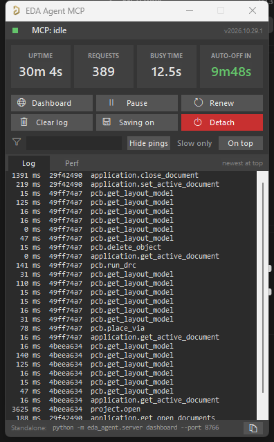
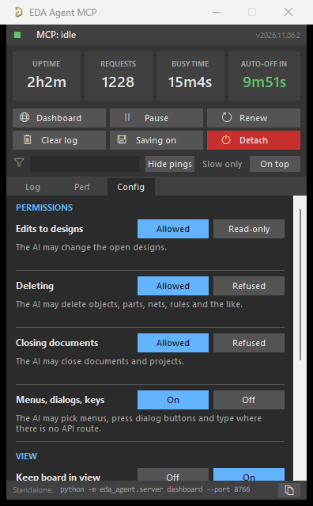

# eda-agent

<h2 class="ea-section-title">Built for real engineering work</h2>
<p class="ea-section-lead">Not a batch script that opens a project and exits. A live connection to the design you have open, for as long as you want it.</p>

<div class="grid cards" markdown>

-   :material-magnify-scan:{ .lg .middle } **Design review in one call**

    ---

    A snapshot, a 31-check lint sweep, ERC and DRC, and schematic-to-PCB
    net cross-checks. The AI grounds every finding in the datasheets it
    actually fetched.

    [:octicons-arrow-right-24: Features](FEATURES.md)

-   :material-lightning-bolt:{ .lg .middle } **Bulk edits, one undo**

    ---

    Nearly every tool takes a list. Twenty arcs, a whole pinout or every
    0402 resistor go in one call and one undo step, 10 to 100 times
    faster than one edit at a time.

    [:octicons-arrow-right-24: Using the tools](USING_THE_TOOLS.md)

-   :material-factory:{ .lg .middle } **Fab output you can trust**

    ---

    Reads your Gerbers and drill files back and checks them against the
    board. Includes dated, sourced JLCPCB and PCBWay stackups and
    laminates.

    [:octicons-arrow-right-24: Fab and calculators](FAB_AND_CALCULATORS.md)

-   :material-calculator-variant:{ .lg .middle } **Calculators with honesty**

    ---

    Spacing, fusing, vias, impedance, PDN. Every result says whether it
    is exact, published or an estimate, and they work on the command line too.

    [:octicons-arrow-right-24: Calculators](FAB_AND_CALCULATORS.md#calculators)

-   :material-account-cog:{ .lg .middle } **Your house style**

    ---

    Profiles hold pad rounding, design rules, ERC levels, fab profiles
    and templates, one per company or project, and the tools apply them
    by themselves.

    [:octicons-arrow-right-24: Profiles](PROFILES.md)

-   :material-robot-outline:{ .lg .middle } **Guided design runs**

    ---

    From spec to board, a reference redraw or a dev-kit derivative.
    Optional NPI gates (EVT, DVT, PVT) hold every run to its checklist.

    [:octicons-arrow-right-24: Design modes](DESIGN_MODES.md)

-   :material-package-variant-closed:{ .lg .middle } **Parts and libraries**

    ---

    Symbols, footprints and 3D models, part search across providers,
    replacement checks, and Altium 365 managed libraries.

    [:octicons-arrow-right-24: Part sourcing](PART_SOURCING.md)

-   :material-chip:{ .lg .middle } **Altium, KiCad, EasyEDA Pro**

    ---

    One tool surface, chosen at startup. Altium is the most complete,
    and KiCad 10 and EasyEDA Pro are there when you need them.

    [:octicons-arrow-right-24: Backends](BACKENDS.md)

</div>

<h2 class="ea-section-title">Up and running in four steps</h2>
<p class="ea-section-lead">Windows, Python 3.11+ and Altium Designer (AD20 or newer is best).</p>

=== "1 · Install"

    ```bash
    git clone https://github.com/MOREmbedded/eda-agent
    cd eda-agent
    python -m pip install -e .
    ```

=== "2 · Connect your AI"

    ```bash
    claude mcp add -s user altium eda-agent
    ```

    If `eda-agent` is not on your `PATH`, use
    `claude mcp add -s user altium -- python -m eda_agent`.
    Any other MCP client: add a local stdio server that runs `eda-agent`.

=== "3 · Load into Altium"

    ```bash
    eda-agent install-scripts
    ```

    In Altium: **Preferences → Scripting System → Global Projects →
    Install from file**, then pick `Altium_API.PrjScr` (once). Start the
    link with **File → Run Script → Altium_API → Dispatcher.pas →
    StartMCPServer**.

=== "4 · Check"

    ```bash
    eda-agent doctor
    ```

    Every line should pass. Then ask: *"List every part on the 3V3 rail
    and flag any whose datasheet limit is below 3.3 V."*

[Full setup guide :octicons-arrow-right-24:](GETTING_STARTED.md){ .md-button .md-button--primary }

<h2 class="ea-section-title">See it inside Altium</h2>
<p class="ea-section-lead">A status window lives in Altium, and a web dashboard covers design review. The Config tab decides what the AI may change.</p>

<div class="ea-shots" markdown>
<figure markdown>

</figure>
<figure markdown>

</figure>
</div>

<h2 class="ea-section-title">Ask it like a reviewer would</h2>

<div class="ea-examples" markdown>

!!! example "Schematic review"
    *"Find all net labels that appear only once across the whole project. Those are probably typos."*

!!! example "Schematic vs PCB drift"
    *"Run `obj_crossref_net` on POE_PG. Is R7 still on this net in the schematic?"*

!!! example "SPICE setup"
    *"Attach SPICE primitives to every passive, fetch vendor models for the op-amps, and tell me what can't be simulated."*

!!! example "Bulk change"
    *"Every 0402 10k resistor: set Tolerance to 1% and Voltage to 50V."*

</div>

[More example prompts :octicons-arrow-right-24:](FEATURES.md#example-use-cases)

!!! warning "Experimental"
    Not every tool is tested on every Altium version, and some can crash
    Altium's script engine. Back up your project first and read
    [Known limitations](LIMITATIONS.md).
